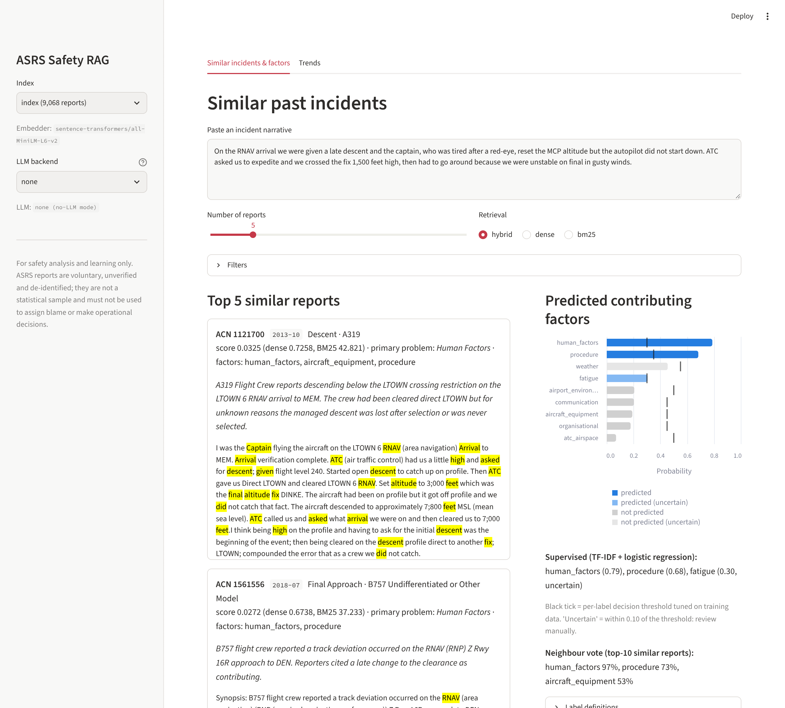
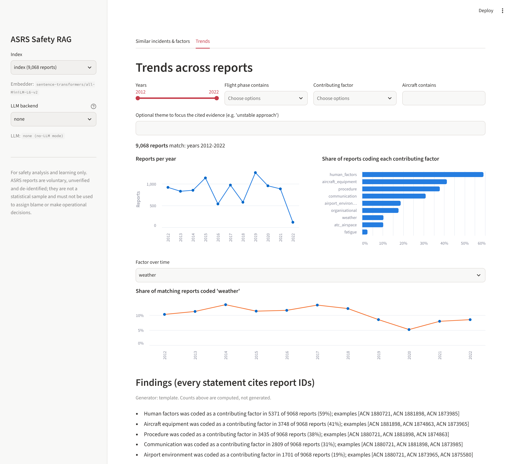
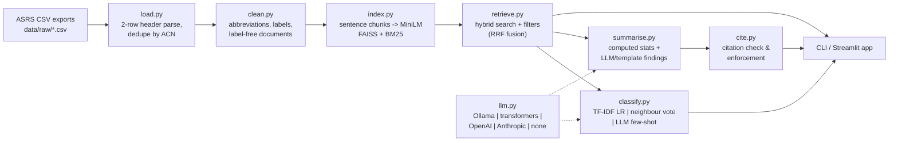
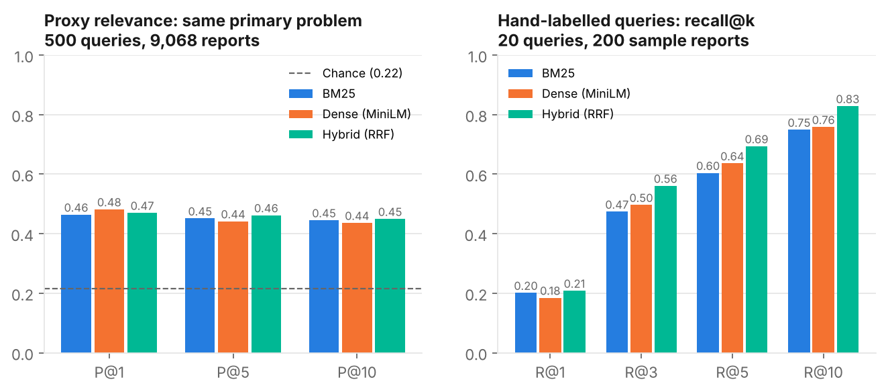
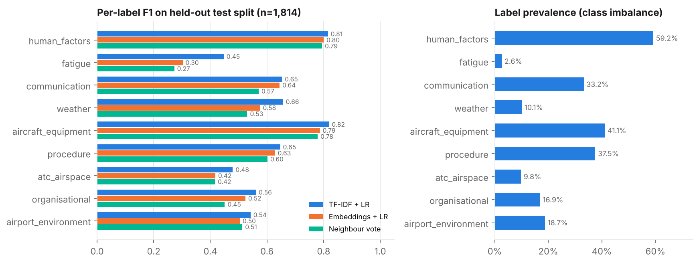
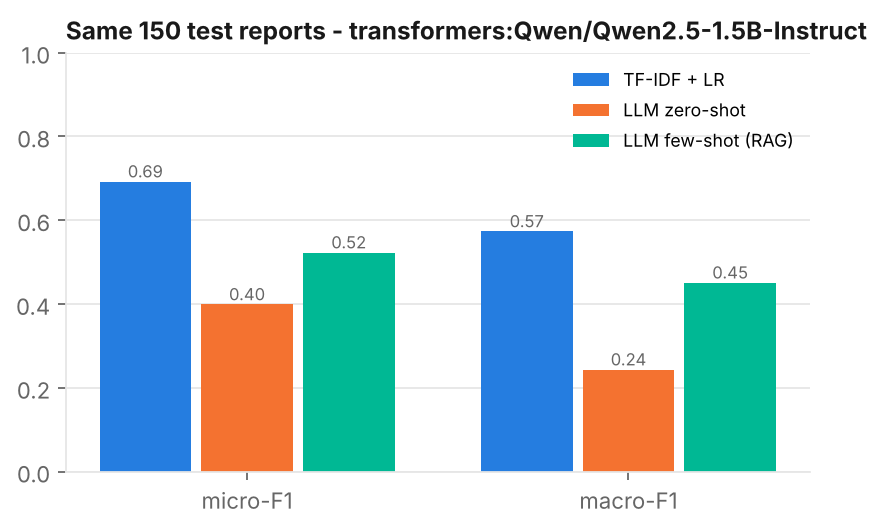
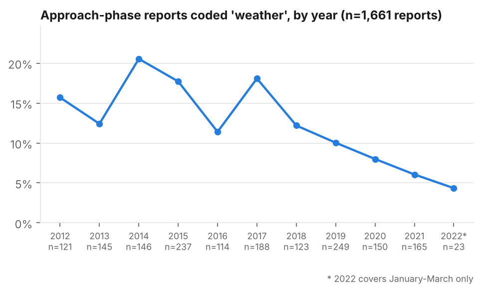

# asrs-safety-rag

[](https://github.com/Abhishek2993/asrs-safety-rag/actions/workflows/ci.yml)


Retrieval-augmented analysis of **NASA Aviation Safety Reporting System (ASRS)** incident
reports. Given a new incident narrative it:

1. **retrieves the most similar past incidents** (hybrid BM25 + dense retrieval with metadata filters);
2. **classifies contributing factors** (human factors, fatigue, communication, weather, aircraft
   equipment, procedure, ATC/airspace, organisational, airport/environment) with a supervised
   baseline and an LLM using retrieved reports as examples;
3. **summarises trends** over a filtered set of reports, where counts are computed and every
   generated statement must cite the ASRS report IDs (ACNs) it is based on, enforced by a
   citation check.

Everything runs locally on a CPU with no API key; an LLM is optional.



> **Intended use.** Safety analysis, research and learning. ASRS reports are voluntary,
> de-identified and unverified. This tool must not be used to assign blame or to make
> operational decisions (see [Limitations and ethics](#6-limitations-and-ethical-note)).

**Contents:** [1 Summary](#1-summary) · [2 Requirements](#2-requirements) ·
[3 Architecture](#3-architecture) · [4 Hazard analysis](#4-hazard-and-failure-analysis) ·
[5 Evaluation](#5-evaluation-results) · [6 Limitations and ethics](#6-limitations-and-ethical-note) ·
[7 Data and running](#7-getting-the-data-and-running) · [Learning guide](docs/LEARNING.md)

---

## 1. Summary

| | |
|---|---|
| Corpus used for the results | 9,068 unique ASRS reports, 2012-2022 (28,359 chunks) |
| Committed sample | 200 reports in `data/sample/` (runs out of the box) |
| Embedding model | `sentence-transformers/all-MiniLM-L6-v2` (384-d, CPU) |
| Vector index | FAISS exact inner product + sparse BM25, fused with Reciprocal Rank Fusion |
| Retrieval, hand-labelled queries | hybrid **P@3 = 0.92**, **R@10 = 0.83**, MRR = 1.00 (20 queries) |
| Classification, held-out test set | TF-IDF + logistic regression **micro-F1 = 0.69**, macro-F1 = 0.62 (1,814 reports) |
| LLM (local, CPU) | Qwen2.5-1.5B-Instruct micro-F1 0.40 zero-shot -> **0.52 few-shot with retrieved examples** (supervised: 0.69 on the same 150 reports) |
| Citation faithfulness | 100% of LLM citations valid and 100% of statements cited (10 summaries); 28% of statements flagged as weakly supported, see [5.4](#54-summary-faithfulness) |
| Tests | 108 pytest tests, no model download needed; ruff + pytest in GitHub Actions |

The app's second page shows the trend view for a filter (counts per year, factor shares,
cited findings and the citation-check result).



## 2. Requirements

Requirements are numbered so the hazard analysis and tests can refer to them.

### Functional requirements

| ID | Requirement | Where |
|---|---|---|
| FR-1 | Load ASRS Database Online CSV exports (two-row header, ACN, date, narrative, synopsis, primary problem, contributing factors, flight phase, aircraft, anomaly) from one or many files and deduplicate by ACN. | `load.py`, `tests/test_load.py` |
| FR-2 | Clean narratives and expand ASRS abbreviations with a documented dictionary. | `clean.py`, `abbreviations.py` |
| FR-3 | Given a narrative, return the top-*k* similar reports with scores, metadata and highlighted matching terms, optionally filtered by date, flight phase, aircraft type, primary problem and factor. | `retrieve.py` |
| FR-4 | Predict contributing factors (multi-label) with a confidence for each label, without any LLM. | `classify.SupervisedClassifier` |
| FR-5 | Predict contributing factors with an LLM using retrieved similar reports as few-shot context, and compare it with FR-4 on the same held-out data. | `classify.LLMClassifier`, `eval.py` |
| FR-6 | **Every generated statement must cite report IDs (ACNs), and every cited ACN must be one of the reports supplied to the generator.** Statements failing this are removed and listed. | `cite.py`, `summarise.py` |
| FR-7 | Summarise a filtered set: counts over time, top contributing factors, top primary problems, cited findings. | `summarise.py` |
| FR-8 | Provide a CLI (`index`, `query`, `classify`, `summarise`, `train`, `evaluate`) and a Streamlit app. | `cli.py`, `app/app.py` |
| FR-9 | Evaluate retrieval (precision@k, recall@k, MRR), classification (micro/macro F1, confusion summary) and citation faithfulness, writing results to `results/`. | `eval.py` |

### Non-functional requirements

| ID | Requirement | How it is met |
|---|---|---|
| NFR-1 | Runs offline on a CPU without API keys. | local MiniLM embeddings; LLM optional; no-LLM mode |
| NFR-2 | API keys are never hard-coded, logged or committed. | keys read only from env vars in `llm.py`; tested |
| NFR-3 | Numbers shown to users are computed deterministically, never generated. | statistics in pandas; LLM prompt forbids numbers |
| NFR-4 | Reproducible results. | pinned dependencies, fixed seeds, saved split (`results/split.json`), temperature 0 |
| NFR-5 | Query latency under 1 s on the 9k-report corpus on a laptop CPU. | measured ~0.05 s per filtered hybrid query, query embedding included (9,068 reports, 4 CPU cores) |
| NFR-6 | CI does not download models. | hashing embedder and fake LLMs in tests |
| NFR-7 | Only fields available at reporting time are used as model inputs (no label leakage). | analyst-coded fields excluded from documents and features |

## 3. Architecture



| Stage | Key decision (details in [docs/LEARNING.md](docs/LEARNING.md)) |
|---|---|
| Load | Header located by the `ACN` cell; group row forward-filled; richest duplicate kept. |
| Clean | Shorthand replaced (`ACFT` -> aircraft); acronyms kept + expanded once (`TCAS (traffic collision avoidance system)`); coded analyst fields excluded from text. |
| Index | 160-word sentence-aligned chunks with 40-word overlap (MiniLM reads ~190 words); exact FAISS; BM25 as a precomputed sparse matrix. |
| Retrieve | Filters applied before ranking; chunk scores max-pooled per report; RRF (k = 60) fuses dense and BM25 ranks. |
| Classify | Narrative-only input; one-vs-rest logistic regression, balanced class weights, per-label thresholds tuned out-of-fold. |
| Summarise | Counts computed; LLM writes qualitative findings from a fixed evidence set; citations checked and enforced. |

## 4. Hazard and failure analysis

Each hazard is a way the tool could mislead an analyst. Severity is the effect on a safety
analysis if undetected; mitigations are implemented and tested unless marked *procedural*.

| # | Hazard | Cause | Effect | Mitigation | Verification |
|---|---|---|---|---|---|
| H1 | **Hallucinated causes** | LLM states a cause not in any report, or attaches a detail to reports that do not contain it | Wrong safety lesson drawn | Findings may only use the supplied evidence reports; each statement must cite them (FR-6); statements without a valid citation are removed; lexical support score and broad-citation rate flag weak claims; evidence shown beside findings; numbers never generated (NFR-3). **Residual risk:** a valid citation does not prove support (5.4 found an unsupported detail behind valid citations; 28% of statements low-support) - findings require analyst review | `tests/test_cite.py`, `tests/test_summarise.py`; faithfulness eval (5.4) |
| H2 | **Wrong citations** | LLM cites an ACN that was not supplied, or mistypes one | Analyst follows a reference that does not support the claim | Every cited ACN checked against the evidence set; invalid ones reported and stripped; evidence table shown in the app | `cite.check_citations`, faithfulness eval |
| H3 | **Class imbalance** | Fatigue is in 2.6% of reports, ATC/airspace and weather ~10% | Rare but important factors missed; good average scores hide this | Balanced class weights; per-label thresholds; **macro-F1 and per-label scores reported, not only micro-F1**; uncertainty flag when probability is within 0.10 of the threshold | Table 5.2; `tests/test_classify.py` |
| H4 | **Outdated reports / concept drift** | Language, procedures and coding change over time (e.g. COVID-19-era events coded as *Environment - Non Weather Related*) | Model trained on old data misclassifies new reports | Temporal evaluation (train 2012-2019, test 2020-2022) quantifies the drop; date filters in retrieval and trends; retrain with `python -m asrs_rag train` on new exports | Table 5.2 (temporal row): airport/environment F1 falls from 0.54 to 0.33 |
| H5 | **Sensitive data** | Narratives could contain identifying details; users might paste non-public text into an API backend | Privacy breach, loss of reporter trust | Only NASA's de-identified public data is used and committed; local LLM by default; API backends only when explicitly configured; keys from env only; *procedural*: do not paste confidential or identifying text when using an API backend | `tests/test_llm.py` |
| H6 | **Label leakage** | Coded fields (primary problem, factors) included in model input | Over-optimistic evaluation | Coded fields excluded from documents and features; LLM few-shot examples drawn from the training split only | `tests/test_clean.py` (document has no labels); split saved in `results/split.json` |
| H7 | **Over-trust in retrieval** | "Similar" report is topically related but not causally similar | False analogy | Scores, matched terms and the matching passage are shown; proxy evaluation reports precision against chance | Section 5.1 |
| H8 | **LLM unavailable or failing** | No server/key, timeout, malformed output | Feature silently degrades | `no-LLM` mode is the default fall-back: retrieval, supervised classifier and template summaries still work; LLM errors fall back to the template; malformed JSON parsed leniently, unknown labels dropped | `tests/test_summarise.py`, `tests/test_llm.py` |
| H9 | **Misuse for blame** | Outputs read as findings about individuals | Undermines the voluntary, non-punitive reporting system | Disclaimers in app and README; no reporter-level aggregation; prompts forbid assigning blame | *procedural* |

## 5. Evaluation results

All numbers below were produced by `python -m asrs_rag evaluate ...` on the corpus described in
[section 7](#7-getting-the-data-and-running) and are stored in `results/*.json`. Figures are
generated from those files by `scripts/make_figures.py`.

### 5.1 Retrieval

**Hand-labelled queries** (20 newly written narratives; relevance judged against all 200
reports in `data/sample/`, 5.8 relevant reports per query on average; labels in
`data/eval/queries.jsonl`, pending owner review):

| Method | P@1 | P@3 | P@5 | P@10 | R@5 | R@10 | MRR |
|---|---|---|---|---|---|---|---|
| BM25 | 0.95 | 0.77 | 0.62 | 0.41 | 0.60 | 0.75 | 0.98 |
| Dense (MiniLM) | 0.85 | 0.80 | 0.64 | 0.41 | 0.64 | 0.76 | 0.90 |
| **Hybrid (RRF)** | **1.00** | **0.92** | **0.71** | **0.45** | **0.69** | **0.83** | **1.00** |

P@10 is bounded by the number of relevant reports (~5.8 per query), so 0.45 is close to the
ceiling of ~0.58.

**Proxy relevance at scale** (500 random query reports from the 9,068-report index, the query
report excluded; a result is relevant if it has the same ASRS *primary problem*):

| Method | P@1 | P@5 | P@10 | MRR |
|---|---|---|---|---|
| Chance (random ranking) | 0.22 | 0.22 | 0.22 | - |
| BM25 | 0.46 | 0.45 | 0.45 | 0.61 |
| Dense (MiniLM) | 0.48 | 0.44 | 0.44 | 0.61 |
| **Hybrid (RRF)** | 0.47 | **0.46** | **0.45** | **0.61** |

All methods retrieve same-problem reports at about twice the chance rate; hybrid is best at P@5, P@10 and MRR, dense at P@1, and the differences on this coarse proxy are small (500 queries). Recall@k is not
meaningful for this proxy (each query has hundreds to thousands of "relevant" reports;
hybrid R@10 = 0.003) and is kept only in the JSON. The proxy is coarse ("Human Factors"
alone covers 32% of reports), which is why the hand-labelled set is the primary measure.



### 5.2 Contributing-factor classification (supervised and retrieval baselines)

Random 80/20 report-level split (seed 13): 7,254 training and 1,814 test reports. Inputs are
narratives only. Thresholds tuned by 5-fold cross-validation on the training split.

| Model | micro-P | micro-R | **micro-F1** | **macro-F1** | exact match |
|---|---|---|---|---|---|
| **TF-IDF + logistic regression** | 0.61 | 0.81 | **0.69** | **0.62** | 0.20 |
| MiniLM embeddings + logistic regression | 0.58 | 0.78 | 0.66 | 0.58 | 0.18 |
| Neighbour vote (top-10 retrieved, no training) | 0.58 | 0.71 | 0.64 | 0.55 | 0.18 |
| TF-IDF + LR, **temporal split** (train 2012-19, test 2020-22, n = 1,963) | 0.60 | 0.71 | 0.65 | 0.58 | 0.17 |

Per-label F1 on the random test split (TF-IDF + LR) with test prevalence:

| Label | Prevalence | Precision | Recall | F1 | Temporal-split F1 |
|---|---|---|---|---|---|
| human_factors | 59.2% | 0.72 | 0.93 | 0.81 | 0.83 |
| aircraft_equipment | 41.1% | 0.81 | 0.82 | 0.82 | 0.81 |
| procedure | 37.5% | 0.53 | 0.83 | 0.65 | 0.55 |
| communication | 33.2% | 0.54 | 0.82 | 0.65 | 0.64 |
| airport_environment | 18.7% | 0.49 | 0.61 | 0.54 | **0.33** |
| organisational | 16.9% | 0.48 | 0.68 | 0.56 | 0.54 |
| weather | 10.1% | 0.61 | 0.70 | 0.66 | 0.57 |
| atc_airspace | 9.8% | 0.39 | 0.61 | 0.48 | 0.48 |
| **fatigue** | **2.6%** | 0.51 | 0.40 | **0.45** | 0.53 |

**Confusion summary** (most frequent "missed A, predicted B instead" pairs in the same
report): aircraft_equipment -> procedure (50), airport_environment -> procedure (45),
aircraft_equipment -> communication (37), aircraft_equipment -> human_factors (34),
atc_airspace -> procedure (32), procedure -> human_factors (32). *Procedure* absorbs errors
from several categories: in ASRS coding it frequently co-occurs with them, and the boundary
between "a procedure was not followed" and the underlying cause is itself an analyst judgment.

Observations:
* TF-IDF beats sentence embeddings here: factor labels hinge on specific words ("fatigue",
  "MEL", "turbulence") that sparse features keep and a 384-d sentence embedding blurs.
* The largest temporal drop is *airport_environment* (0.54 -> 0.33): in 2020-2022 that code
  absorbed COVID-19-related events (masks, staffing) that rarely appear before 2020; the model's
  top terms for the label include `covid` and `mask`. This is hazard H4 made concrete.



### 5.3 LLM classification: zero-shot vs few-shot RAG

A seeded sample of **150 reports from the same held-out test split**, so all rows below are
scored on identical data. LLM: **Qwen2.5-1.5B-Instruct** (local, CPU, temperature 0, in-process
`transformers` backend). Few-shot = the 4 most similar *training* reports (hybrid retrieval)
with their coded labels in the prompt.

| Model (same 150 test reports) | micro-P | micro-R | **micro-F1** | **macro-F1** | exact match | s / report |
|---|---|---|---|---|---|---|
| LLM zero-shot | 0.33 | 0.51 | 0.40 | 0.24 | 0.01 | 10.3 |
| LLM few-shot (RAG, 4 examples) | 0.43 | 0.66 | **0.52** | **0.45** | 0.02 | 10.7 |
| TF-IDF + logistic regression | 0.60 | 0.82 | **0.69** | **0.57** | 0.25 | < 0.01 |
| MiniLM embeddings + logistic regression | 0.59 | 0.78 | 0.67 | 0.54 | 0.25 | < 0.01 |

Per-label F1 on this sample (support in brackets):

| Label | Zero-shot | Few-shot (RAG) | TF-IDF + LR |
|---|---|---|---|
| human_factors (90) | 0.73 | 0.77 | 0.84 |
| aircraft_equipment (57) | 0.13 | 0.61 | 0.79 |
| procedure (52) | 0.15 | 0.42 | 0.67 |
| communication (44) | 0.48 | 0.53 | 0.64 |
| airport_environment (23) | 0.00 | 0.51 | 0.51 |
| atc_airspace (21) | 0.26 | 0.26 | 0.57 |
| weather (20) | 0.00 | 0.54 | 0.57 |
| organisational (20) | 0.24 | 0.27 | 0.56 |
| fatigue (3) | 0.19 | 0.14 | 0.00 |

Findings:
* **Retrieval helps the LLM a lot:** few-shot examples raise micro-F1 from 0.40 to 0.52 and
  macro-F1 from 0.24 to 0.45. The biggest gains are on labels whose ASRS meaning is a coding
  convention the model cannot guess from the label name alone (weather 0.00 -> 0.54,
  airport_environment 0.00 -> 0.51, aircraft_equipment 0.13 -> 0.61).
* **The 1.5B local model does not beat the supervised baseline.** It over-predicts
  (precision 0.43 vs 0.60), especially *atc_airspace* and *organisational*. This supports
  keeping the supervised model as the default and the LLM as an optional second opinion
  (hazard H1/H8). A larger model can be evaluated with the same command
  (`--llm ollama --llm-model <model>` or an API backend).
* Fatigue has only 3 positives in this sample, so its per-label scores here are not meaningful;
  use the full test split in 5.2 for fatigue.
* Raw LLM outputs and the examples used for every report are saved in
  `results/llm_predictions.jsonl` for audit.



### 5.4 Summary faithfulness

Ten trend summaries (filters listed in `eval.SUMMARY_FILTERS`, e.g. *approach phase,
2020-2022, weather*; *cruise, fatigue*; *taxi, communication*) were generated by
Qwen2.5-1.5B-Instruct from evidence sets of 10 reports each, then scored **before**
enforcement. Results: `results/faithfulness.json` (raw and enforced text of every summary
included).

| Metric (50 generated statements) | Value | Meaning |
|---|---|---|
| Citation precision | **1.00** | every cited ACN was one of the supplied evidence reports (no invented IDs) |
| Statement coverage | **1.00** | every statement carried at least one valid citation |
| Summaries passing the check unmodified | 10 / 10 | |
| Mean citations per statement | 2.98 | |
| Broad statements (> 5 citations) | **20%** | "citation dumping": one generic claim backed by most of the evidence set |
| Mean lexical support | 0.30 | share of a statement's content words found in its cited reports |
| Low-support statements (support < 0.2) | **28%** | flagged for human review |

**Interpretation.** The structural requirement (FR-6) held perfectly: the small model never
invented an ACN and never left a statement uncited, and enforcement would have removed any
that did (after enforcement 100% of displayed statements are grounded by construction).
But a valid citation is not proof of support. A manual spot-check found, for example, the
claim that weather "even [led to] runway incursions" in the approach/weather summary,
while none of the eight reports it cites mentions a runway incursion. Generic statements
citing almost the whole evidence set ("fatigue ... has been linked to increased risk of
accidents") were common in the fatigue summaries. These are the residual risk of hazard
H1. The low-support flag and the broad-statement rate make them measurable. They are why
the app shows the evidence reports next to the findings and why findings must be checked
by an analyst. A larger LLM, or one claim per cited report, would be the next improvement.

The metrics can be recomputed from the stored outputs without an LLM:
`python -m asrs_rag evaluate faithfulness --rescore`.

### 5.5 Example trend output (no-LLM mode)

`python -m asrs_rag summarise --phase approach --from 2020 --to 2022 --factor weather --llm none`

```text
Filter: flight phase contains approach; years 2020-2022; factor weather  ->  23 reports

Reports per year: 2020: 12, 2021: 10, 2022: 1
Top contributing factors: weather (23), human_factors (18), aircraft_equipment (6), procedure (5), airport_environment (5), communication (4)
Top primary problems: Human Factors (10), Weather (6), Aircraft (2), Environment - Non Weather Related (2), ATC Equipment / Nav Facility / Buildings (1), Procedure (1)

Findings (generator: template):
- Weather was coded as a contributing factor in 23 of 23 reports (100%); examples [ACN 1868999, ACN 1861720, ACN 1864918]
- Human factors was coded as a contributing factor in 18 of 23 reports (78%); examples [ACN 1868999, ACN 1861720, ACN 1864918]
- Aircraft equipment was coded as a contributing factor in 6 of 23 reports (26%); examples [ACN 1861720, ACN 1864918, ACN 1817741]
- Procedure was coded as a contributing factor in 5 of 23 reports (22%); examples [ACN 1819866, ACN 1790703, ACN 1768874]
- Airport environment was coded as a contributing factor in 5 of 23 reports (22%); examples [ACN 1819866, ACN 1790703]

Citation check: 14/14 citations valid, statement coverage 100%, 0 ungrounded statement(s) removed.
```

(The corpus used here ends in early 2022, hence the single 2022 report.)



## 6. Limitations and ethical note

**About the data.**
* ASRS is a **voluntary, confidential, non-punitive** reporting programme run by NASA for the
  FAA. Reports are first-person accounts that are **not verified**, and reporting rates depend
  on awareness, incentives and events. Counts therefore describe *what was reported*, **not how
  often things happen**; ASRS data are not a statistically representative sample and must not
  be used to estimate rates or compare operators, aircraft types or airports.
* Reports are **de-identified** by NASA (locations become `ZZZ`, call signs `X`/`Y`). This
  project never attempts re-identification and never aggregates by reporter.
* Analyst coding (primary problem, contributing factors) is a judgment; categories overlap
  (*procedure* vs *human factors*), so the "ground truth" for classification is itself noisy.
  Multiple ASRS reports about the same event (e.g. from the captain and the first officer) have
  different ACNs and can make retrieval look better than it would on unique events.

**About the models.**
* The supervised classifier reaches micro-F1 0.69; it is a triage aid, not an analyst. Rare
  factors (fatigue, F1 0.45) are the hardest and the most safety-relevant.
* The proxy retrieval metric is coarse and the hand-labelled set is small (20 queries, 200
  reports) and was labelled by the project author pending review.
* The local LLM is a 1.5B-parameter model chosen to run on a CPU. Its results are a lower bound;
  the same harness evaluates any stronger model via `--llm` / `ASRS_RAG_LLM_MODEL`.
  The published LLM results used the in-process `transformers` backend because an Ollama
  server could not be run in the build environment; the Ollama backend is covered by
  mocked tests only.
* The citation check verifies *which* reports are cited, not *what* is claimed about them;
  lexical support is a heuristic (5.4).
* The corpus used for the published numbers covers 2012 to early 2022. Newer exports should be
  re-indexed and the classifier retrained (hazard H4).

**Ethical note.** The tool supports learning from aggregated safety reports. It is **not** for
assigning blame, investigating individuals, enforcement, or operational decisions (dispatch,
maintenance release, ATC). Doing so would undermine the confidentiality that makes voluntary
reporting work. Any finding should be checked against the cited reports by a qualified analyst.

## 7. Getting the data and running

### 7.1 Install

```bash
git clone https://github.com/Abhishek2993/asrs-safety-rag.git
```

```bash
cd asrs-safety-rag && python3.11 -m venv .venv && source .venv/bin/activate
```

```bash
pip install -e ".[dev]"
```

(For a CPU-only machine, `pip install torch --index-url https://download.pytorch.org/whl/cpu`
first avoids downloading CUDA libraries.)

### 7.2 Run on the committed sample (no download)

```bash
python -m asrs_rag --index-dir data/index_sample index --data data/sample
```

```bash
python -m asrs_rag --index-dir data/index_sample query "Strong burning smell in the cabin after takeoff, we returned to the airport" -k 5
```

```bash
python -m asrs_rag --index-dir data/index_sample evaluate labelled --out results/sample
```

### 7.3 Download ASRS exports (ASRS Database Online)

1. Open **ASRS Database Online** from <https://asrs.arc.nasa.gov/search/database.html> and start
   a new search. Turn off pop-up blockers: the query wizard opens item lists in pop-ups.
2. **Date range:** select **"Date of Incident"** (it moves to the current search) and set the
   start and end month, e.g. 01/2018 to 12/2024. Optionally add filters such as Flight Phase.
3. **Display fields:** the wizard lets you choose exactly which fields to display/export.
   Include at least the fields this loader reads (all others are ignored safely):
   * **ACN** (always included)
   * **Time:** Date, Local Time Of Day
   * **Place:** Locale Reference, State Reference
   * **Environment:** Flight Conditions, Weather Elements / Visibility, Light
   * **Aircraft 1:** Aircraft Operator, Make Model Name, Operating Under FAR Part, Flight Plan,
     Flight Phase, Airspace
   * **Component:** Aircraft Component, Problem
   * **Person 1 / Person 2:** Reporter Organization, Function, Human Factors, Communication Breakdown
   * **Events:** Anomaly, Detector, When Detected, Result
   * **Assessments:** Contributing Factors / Situations, Primary Problem
   * **Report 1 / Report 2:** Narrative, Callback, Synopsis
4. **Run Search**, then export the results as **CSV**. Each export holds at most **10,000
   reports**, so split long date ranges into several searches.
5. Save the files as `data/raw/*.csv` (any names). Overlapping files are fine: reports are
   deduplicated by ACN.

Please credit NASA ASRS when you publish results, and read ASRS's own notes on the
limitations of the data on its website.

**Reproducing the published numbers without the web export.** The results above used 9,068
reports from the public Hugging Face mirror `elihoole/asrs-aviation-reports` (ASRS Database
Online records, validation + test splits), converted back to the export format:

```bash
python scripts/fetch_asrs_mirror.py --splits validation test --out data/raw
```

### 7.4 Build, train, query, summarise

```bash
python -m asrs_rag index
```

```bash
python -m asrs_rag train
```

```bash
python -m asrs_rag query "On short final we encountered wind shear and went around" -k 5 --phase approach
```

```bash
python -m asrs_rag classify "The first officer was exhausted after a red-eye and missed the altitude restriction"
```

```bash
python -m asrs_rag summarise --phase approach --from 2020 --to 2022 --factor weather
```

```bash
streamlit run app/app.py
```

### 7.5 LLM backends

The LLM is optional. Select it with `--llm` or `ASRS_RAG_LLM`; keys are read only from the
environment.

| Backend | Setting | Notes |
|---|---|---|
| none | `ASRS_RAG_LLM=none` | deterministic; template summaries |
| Ollama (default when reachable) | `ollama pull qwen2.5:1.5b` then `ASRS_RAG_LLM=ollama` | `OLLAMA_HOST` to change the server |
| transformers (in-process) | `ASRS_RAG_LLM=transformers` | downloads `Qwen/Qwen2.5-1.5B-Instruct` (~3 GB); used for the results in 5.3-5.4 |
| OpenAI-compatible | `OPENAI_API_KEY=...`, `ASRS_RAG_LLM=openai` | `OPENAI_BASE_URL` for vLLM / LM Studio |
| Anthropic | `ANTHROPIC_API_KEY=...`, `ASRS_RAG_LLM=anthropic` | |

`ASRS_RAG_LLM_MODEL` overrides the model of any backend.

### 7.6 Reproduce the evaluation

```bash
python -m asrs_rag evaluate retrieval --n 500
```

```bash
python -m asrs_rag evaluate classification
```

```bash
python -m asrs_rag --llm transformers evaluate llm --n 150
```

```bash
python -m asrs_rag --llm transformers evaluate faithfulness
```

```bash
python scripts/make_figures.py
```

### 7.7 Tests and lint

```bash
pytest
```

```bash
ruff check . && ruff format --check .
```

## Project layout

```text
src/asrs_rag/
  load.py           ASRS export parser (two-row header, dedupe by ACN)
  abbreviations.py  documented abbreviation dictionary
  clean.py          text cleaning, label-free documents
  labels.py         ASRS codes -> nine analysis labels
  embed.py          sentence-transformers / hashing embedders
  bm25.py           sparse-matrix BM25
  index.py          chunking, FAISS + BM25 index (save/load)
  retrieve.py       hybrid retrieval, filters, RRF
  classify.py       supervised, neighbour-vote and LLM classifiers
  llm.py            Ollama / transformers / OpenAI / Anthropic / none
  summarise.py      trend statistics and cited findings
  cite.py           citation extraction, checking, enforcement
  metrics.py        multi-label and retrieval metrics
  eval.py           evaluation harness
  cli.py            python -m asrs_rag ...
app/app.py          Streamlit app
scripts/            mirror download, figures, screenshots
data/sample/        200 committed ASRS reports
data/eval/          20 hand-labelled retrieval queries
results/            evaluation outputs used in this README
docs/               figures and LEARNING.md
```

## Licence and data credit

Code: MIT (see `LICENSE`). Data: NASA Aviation Safety Reporting System
(<https://asrs.arc.nasa.gov/>); the committed sample is a small de-identified extract for
demonstration.
